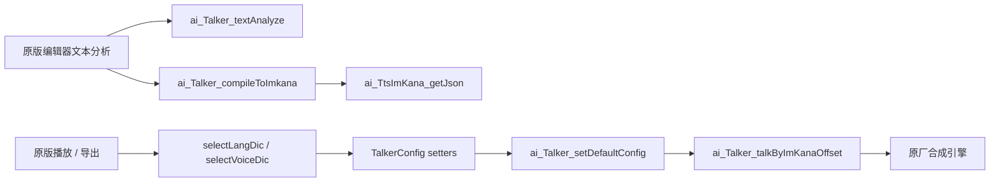

# A.I.VOICE2 Editor 本机分析记录

公开仓库包含接口发现和验证摘要。本文引用的原始 `evidence/` 记录仅保存在开发机，未上传原厂反编译结果或本机运行数据。

当前部署使用根目录 `window_size_plugin.dll` 替换桥：原 EXE 的静态导入提供自动加载入口，桥接 DLL 在 `WindowSizePluginRegisterWithRegistrar` 中转调同目录备份原插件的同名函数。API 监听、持久任务队列和合成均位于原编辑器进程。导入证据为 `evidence/autoload-imports.json`，桥的 PE 导入/导出为 `evidence/dropin-pe.txt`，实际加载模块和实测结果为 `evidence/dropin-e2e.json`、`evidence/dropin-restart.json`。当前验收以 `docs/DROPIN-VALIDATION.md` 为准。

目标：标准安装目录中的 A.I.VOICE2 Editor，安装版本 2.13.0，Windows x64。全部分析留在本机。文件哈希、方法和验证范围以 `../evidence/findings.json` 为结构化索引。

## 工具和可重现性

- REA 6.5.0：来源 [morluto/rea](https://github.com/morluto/rea) / npm `rea-agents`，本地固定版本位于 `tools/rea`。
- Ghidra 12.1.4：官方 [NSA 发布](https://github.com/NationalSecurityAgency/ghidra/releases/tag/Ghidra_12.1.4_build)，本地 `tools/ghidra/ghidra_12.1.4_PUBLIC`，使用现有 JDK 23，REA doctor 确认可用。
- ILSpyCmd 11.1.0.9782、pefile 2024.8.26、Capstone 5.0.9、Microsoft 签名的 Sysinternals Handle、MSVC 14.44.35207。
- REA 的配置与分析环境仅保留在开发机。原生证据由 `scripts/rea-session.mjs` 启动的真实 REA MCP 会话生成，未将配置写入等同于连接成功。
- `scripts/rea-session.mjs` 对原始 DLL 使用 `open_binary`、`procedure_pseudo_code`，成功生成 `evidence/rea-native/*.json` 的完整 Evidence。`rea-engine-overview.json` 为 REA/Ghidra 的实际分析结果。更早的手工反汇编明确标为 Capstone，不冒充 REA 结果。

## 架构与接口调查

`aivoice.exe` 是 48,640 字节的 PE x64 Flutter 启动程序，导入 `flutter_windows.dll` 和若干 Flutter 插件。`data/app.so` 实际是 Dart AOT 的 ELF x64 文件，含 `package:aivoice/...` 与 `package:aitalk/...` 字符串。文件格式、导入和实际加载模块共同支持 Flutter/Dart 架构判断。

完整二进制清单记录 256 个 EXE/DLL/SO：169 个有 CLI 头的托管二进制、87 个原生/ELF 二进制。大部分托管文件是随附的 .NET 6 运行时；`ailm.dll` 是 `.NETCoreApp,Version=v6.0` 的许可工具，引用 `AI.Framework.License`。这些文件的存在不证明编辑器的合成逻辑是 .NET。未找到二代版 `AI.Talk.Editor.Api.dll` 或 `TtsControl` 合成程序集。

原始进程实际加载 `Lib/AITalk/aitalk_engine.dll`、`onnxruntime.dll`、`torch_cpu.dll`、`c10.dll` 等。引擎导出 316 个符号。C ABI 的 `ai_Talker_*`、`ai_TalkerConfig_*`、`ai_TtsCallbackSink_*` 是本次使用的真实接口；`Talker` 这个名称也出现在引擎自身诊断字符串中，没有原厂头文件，文档中的签名是分析和运行验证过的局部 ABI。

本次 TCP 快照没有发现编辑器的监听端口。HKCR 对 `AIVoice2` 数据的搜索命中 `.aieprojx`、`AIVoice2.Editor\shell\open\command` 等四处文件关联记录，没有发现可用的合成 COM 注册。Handle 记录中的 `ControlAPIEvent_*` 不能据名称断定是语音接口；进一步扫描已加载模块，字符串来自 Intel 驱动的 `IntelControlLib.dll`。也不能把一般 OLE ALPC 句柄视为 TTS COM API。

这些是有界调查，不能据此证明所有潜在 IPC/COM 接口不存在。没有发现可验证且满足合成需求的现成进程外接口，因此选择已成功验证的进程内 C ABI。

在新的外部 Python 进程单独加载原 DLL，未初始化时调用 `ai_Talker_new()` 返回空。这个测试只证明需要正常初始化，不证明独立托管在所有情况下不可行。为继续沿用原厂正常启动和许可状态，正式桥不调用 `ai_ttsLibraryInitialize`、`ai_ttsLibraryAuthenticate`，而是在正常运行的原版编辑器中创建独立 Talker。声库加载仍走原始 `ai_Talker_loadDic` 及其许可检查，传入安装目录已有的 `voice.lic` 路径，不记录许可内容。

测试工程 `.aieprojx` 的外层是 JSON、版本字段为 `3.0`，内含文本和不透明的 imkana 数据。项目文件自动化属于可继续研究的路线，本交付没有依赖它。

## 播放和导出的调用链

实际触发原版界面的「再生」和「書き出し」，由单独的、仅分析时使用的 DLL 跟踪以下原厂导出入口。原版 UI 导出的 WAV 已保存在 `evidence/editor-ui-export.wav`，48 kHz PCM16 单声道、224,947 帧、约 4.6864 秒。测试工程保存为 `evidence/editor-trace-test.aieprojx`。

原始顺序、线程 ID、对象地址与单调时钟在 `editor-trace-28892.jsonl`，UI 导出成功日志摘录在 `editor-session-log.txt`。跟踪记录证明这些入口在受控操作中被实际调用；**没有恢复完整 Dart 方法栈**。该探针记录的栈数组存在展开限制，不作为调用者身份或地址证据。`AppModelTTS._exportAudioFile`、`textToTuningData`、`tuningDataToSynthesizedData` 等 Dart 名称只在 AOT 字符串中观察到，尚不能据名称把它们的内部调用关系确认为事实。

正式 Bridge 为简洁、重复的文本合成调用 `ai_Talker_talk`，其内部继续使用原始引擎。它不实现编辑器的逐音素项目调谐层，也没有宣称与编辑器全部预处理或导出设置逐项等价。

## 经验证的局部 ABI

所有地址均相对 `aitalk_engine.dll` 的静态首选基址 `0x180000000`；实际地址由 `GetProcAddress` 解析，不把 ASLR 地址写死在正式实现中。

| 导出入口 | 静态 RVA | 用法与验证 |
|---|---:|---|
| `ai_Talker_new` | `0xc1560` | 正常编辑器内返回独立上下文；新外部进程无初始化时返回空 |
| `ai_Talker_loadDic` | `0xc0940` | `(talker,key,path,1,licensePath)`，8 个安装声库加载成功；mode=1 为本次验证的文件路径模式 |
| `ai_Talker_loadLangDic` | `0xc0cb0` | `(talker,key,path,1)`，标准与关西词典加载成功 |
| `ai_Talker_getVoiceDicKeys` | `0xc0630` | 写入 `const char**` 数组并返回数量，探针实测 |
| `ai_Talker_getStyleColorLabelByKey` | `0xc0460` | `(talker,key,index,charBuffer,capacity)`，成功返回 **1**，不能套用其他入口的成功码 0 |
| `ai_TalkerConfig_setRate` | `0xbf650` | `(config,double)`，时长变化实测，非法值 100 返回 -3 |
| `ai_TalkerConfig_setStyleColor` | `0xbf9b0` | `(config,const char*)`；原版传入 `J:0.0,A:0.0,S:0.0,C:0.0,`，修正后风格波形变化实测 |
| `ai_Talker_talk` | `0xc18f0` | `(talker,utf8Text,0)`，同步合成，成功返回 0 |
| `ai_TtsCallbackSink_new` | `0xc22a0` | `(callback,userPointer)`；回调接收用户指针与事件指针 |
| `ai_Talker_setSink` | `0xc1810` | 连接/断开回调，使用后先断开再销毁 sink |

参数范围由原引擎 getter 返回：rate 0.5..4.0，pitch 0.5..2.0，emphasis 上限 2.0。`setVolume`、`setPitch`、`setEmph` 经真实波形能量/哈希变化测试；这些指标证明控制生效，不单独证明音色或听感质量。

## 音频回调与性能

事件结构为 16 字节：32 位类型、对齐、payload 指针。类型 3 为 BUFREQ，类型 4 为 BUFDONE。payload 为 32 字节，依次包含 PCM 指针、字节数、标记缓冲指针、标记容量/数量。标记步长 80 字节由 `FUN_1800ce638` 的复制指令确认。REA/Ghidra 对 `FUN_1800ceeb0`、`FUN_1800ce4f0` 的反编译保留在证据目录。

只提供 PCM 缓冲而把标记缓冲留空，会触发几乎逐采样的 request/done 循环。正式实现提供 262,144 字节 PCM 与 1,024 个标记的缓冲，同一段约 4.23 秒音频仅需 2 次 buffer completion。回调只写入真实引擎提供的 PCM，最后更新 WAV 头并在同目录重命名提交；失败或合作取消清除该任务自己的 `.partial`。

风格入口的早期 JSON 输入返回了成功但波形完全不变；这一失败被真实输出对比发现，随后按原版跟踪结果修正。返回码成功和“参数真正影响输出”被分别验证。

## 正式边界

- 版本和三个关键二进制 SHA-256 固定；更新后必须重新分析，而不是盲目复用局部 ABI。
- 正式后端没有 UI Automation、MinHook、许可补丁、模型或原厂代码复制；UI 仅用于研究与原版导出验证。
- 当前覆盖 8 个二代原生声库。用户自定义的一代/外部声库、用户词典、逐音素调谐以及其他采样格式不在此次验收范围。
- 无引擎硬崩溃后的自动强杀/重启。损坏进程需要用户正常重开原编辑器，根目录 DLL 随之自动加载。没有验证长达数天的运行或不同 Windows/编辑器版本。
